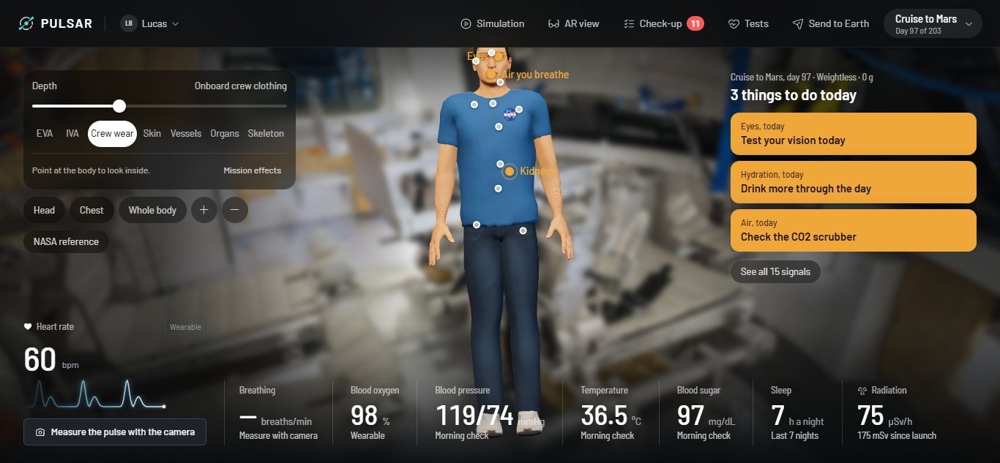
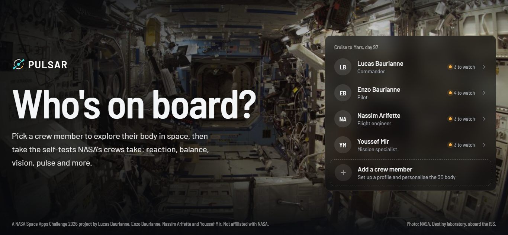
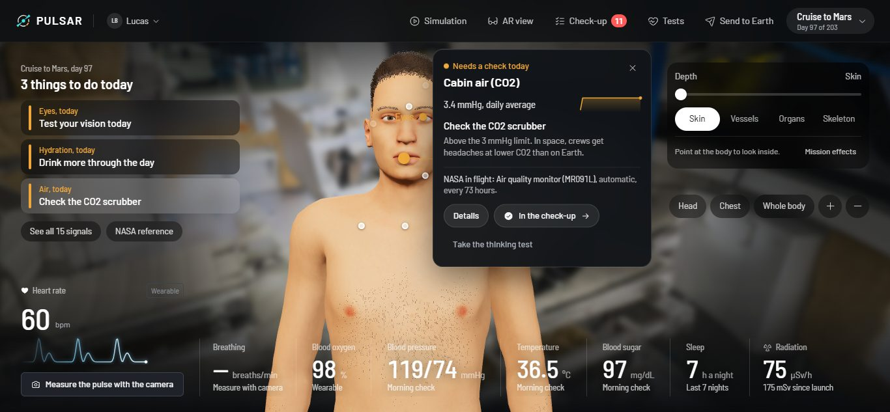
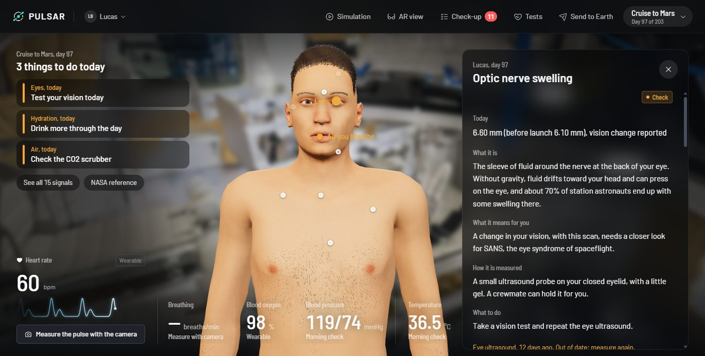
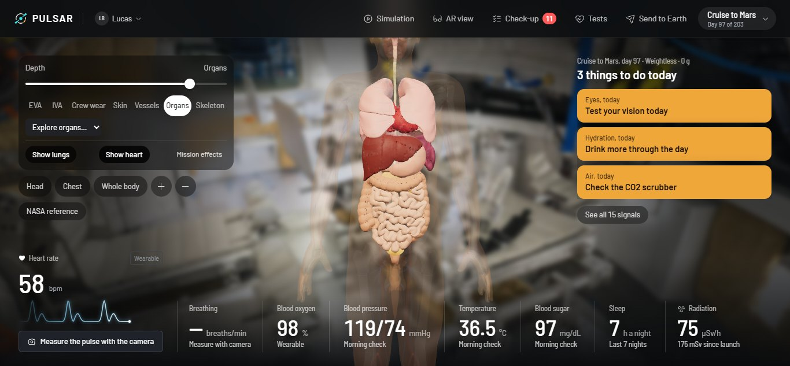
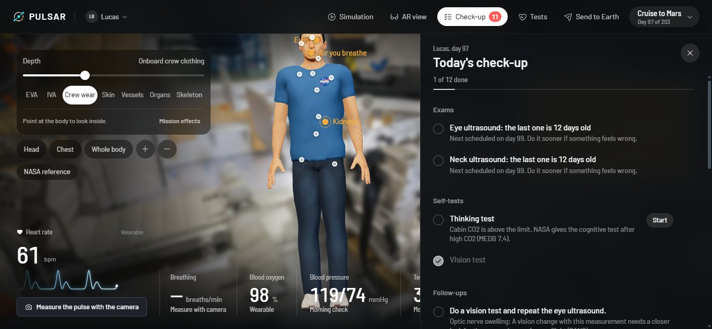
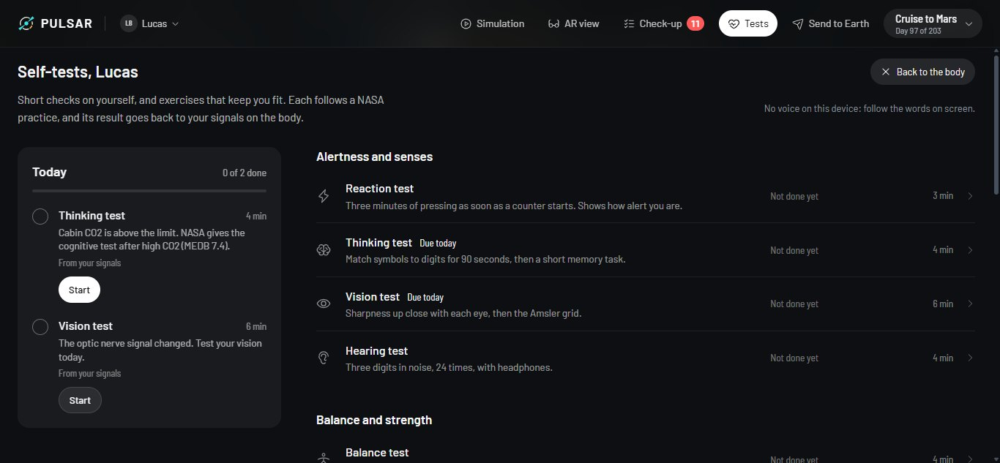
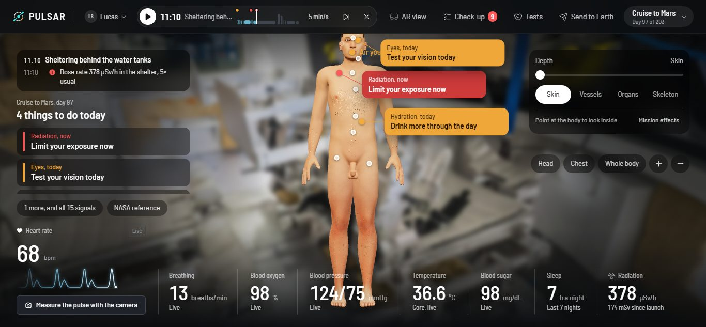
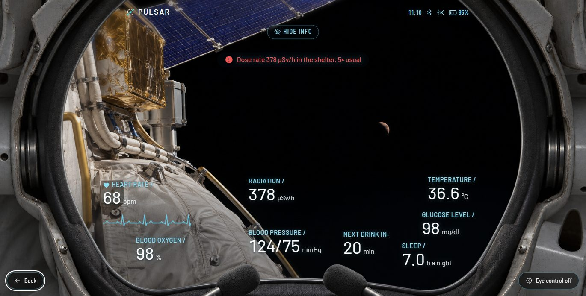
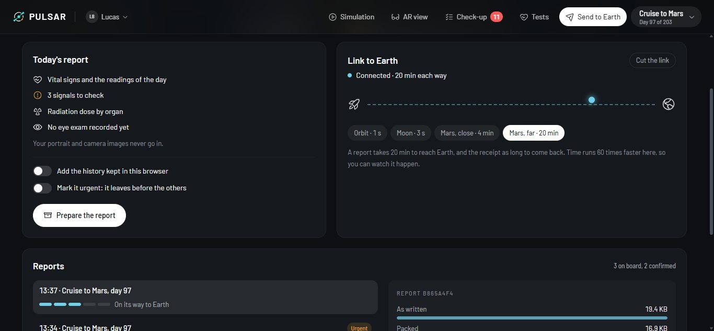

# Pulsar



Pulsar is a health monitor for astronauts. It shows your body in the place you live (the station, the ship to Mars, a base on the Moon or on Mars) and points at what needs looking after today. Click any part of the body and it tells you what it is, what your numbers say and what to do about it.

We built it for the NASA Space Apps Challenge 2026, for the challenge "Create Health Monitoring Software for Astronauts on Space Missions". It is not affiliated with NASA. It is not a medical device either: the crew's health records are made up for the demo, so please don't use it for a real health decision. The self-tests are the exception. They measure you, the person at the computer, and they stay on your computer.

A pulsar is a star whose beam sweeps past with the most regular rhythm in the sky. It seemed like a good name for an app built around a heartbeat.

## Try it

You need Node.js 24 or newer.

```sh
npm ci
npm run dev
```

Then open <http://localhost:5173>.

## A tour

### Pick who's on board



Four crew members are on board, each with their own story over the mission. Pick one to open their dashboard, or add yourself: a call sign, your height and weight, and if you like, your own face on the 3D head, fitted with the webcam. The portrait never leaves your browser.

### Your body, today

The dashboard is the whole app. The controls sit down the left side: how deep to look, the view and the NASA reference. The things to do today run down the right side, most urgent first, red for now and amber for today. Every part that Pulsar follows has a marker on the body: white when it's fine, amber or red when it isn't.



Click a marker or a line of the list. The camera flies to that part and a card opens beside it with the value, its trend over the last 30 days, what to do, and the exam NASA runs in flight for the same question. If it's already on your check-up, **In the check-up** takes you there.

**Details** opens everything about it on the right: what it is, what your value means for you, how it's measured, what to do, the curve since launch, what NASA examines, and the published sources behind the rule.



The vital signs run along the bottom like the numbers on a bedside monitor, with the radiation dose rate at the end. A value outside its limits turns amber or red, with a word that says why, and so does the same reading in the AR view. The 3D heart beats and the chest breathes all the time; start the camera and the heart beats at your own pulse.

The avatar opens in **Crew wear**, a short-sleeved crew shirt and work trousers. The depth control goes from **EVA** (NASA’s EMU spacewalk suit) through **IVA** (the orange ACES launch and entry suit), **Crew wear**, **Skin**, **Vessels**, **Organs** and **Skeleton**. During spacecraft rowing, the dressed avatar slides on a 3D rower with both hands on the handle and both feet strapped to the footplates. Pause to inspect a stroke, or compare the loose straps and hair at mission, lunar, Martian or Earth gravity. On the dashboard the crew member drifts in weightlessness and stands on the floor in surface gravity. A click on an organ shows it on its own: what it does, what space does to it, and which signals are followed there. **Mission effects** runs the physiology model on the body: fluid moving toward the head, bone and muscle loss and the radiation dose, day after day ([how the model works](docs/PHYSIOLOGY.md)).



The radiation details break the dose down by organ (eye lens, skin, blood-forming organs, heart and arteries) against NASA's limits for 30 days, a year and a career, and you can import the doses a radiation team works out. The optic nerve details take your latest eye exam (the retina scan, refraction, eye pressure, folds at the back of the eye) and tell you what needs a second look ([the research behind it](docs/DOSIMETRY_RESEARCH.md)).

### Where you are

The mission menu at the top right sets the destination and the mission day. Orbit is a six-month station stay (180 days), the Moon three days at the south pole, the cruise to Mars 203 days and Mars a 500-day surface stay. Each one brings its own gravity and radiation, its own habitat behind the body, and its own day in the simulation: the station in orbit, the Orion ship on the cruise, a base or a pressurised rover on the Moon, a base on Mars. The station and the ship are NASA photographs; the rover and the bases are illustrations, and the menu says which is which.

### Today's check-up



**Check-up** in the top bar lists the day's tasks: exams that are due or late, NASA's tasks for that flight day, the self-tests due today, a follow-up for each signal that needs one, and the daily routine. Tick them as you go. When every task about a signal is ticked, its marker turns back to white and it leaves the list of things to do. Every task traces back to a value, and the planner is built so that a language model could take its place later without changing the screen.

### Self-tests



[Camera counting results and checks for the 13 self-tests and exercises](docs/SELFTEST_VALIDATION.md)

**Tests** opens short tests you take on yourself, each one modelled on what NASA does with its crews. Your first three runs set your usual result, and later runs are compared with it. A result worse than usual is repeated within 24 hours, as NASA does after a red cognitive test, and every result goes back to the matching signal on the body.

| Test                                  | What NASA does                                                                | How Pulsar measures it                                                                                   |
| ------------------------------------- | ----------------------------------------------------------------------------- | -------------------------------------------------------------------------------------------------------- |
| Reaction, 3 min                       | Reaction Self Test (PVT-B), for fatigue                                       | Keyboard or touch: median response time and lapses of 355 ms or more                                     |
| Thinking, 4 min                       | Cognitive test every month, and after high CO2 or a head injury (MEDB 7.4)    | Two tests from NASA's Cognition battery: digit symbol substitution and a 2-back                          |
| Vision, 6 min                         | Sharpness and Amsler grid on flight days 30 and 90 (MEDB 1.10)                | Tumbling E letters sized with a bank card, at a distance the camera reads from your iris; an Amsler grid |
| Hearing, 4 min                        | Hearing test by flight day 21 (MEDB 1.8)                                      | Digits in noise, with headphones                                                                         |
| Balance, 4 min                        | Balance platform and one-leg stand (MEDB 1.5, 5.1), tandem walk after landing | The camera on your whole body, or your phone's motion sensor held on your chest                          |
| Sit-to-stand, 2 min                   | Standing up from a seat right after landing                                   | The camera, side-on: the time for five stands                                                            |
| Hand dexterity, 2 min                 | Fine motor skills, which drop in the first week in orbit                      | The camera on one hand: pinch, carry and drop eight cells against the clock                              |
| Pulse recovery, 4 min                 | Cycle test with heart rate on flight days 14 and 75 (MEDB N3.07)              | The Ruffier squat test, with the camera or a Bluetooth heart-rate strap                                  |
| Resting pulse, breathing rate         | Vital signs in the health checks (MEDB 1.2)                                   | The camera: the colour of your skin, and your chest moving                                               |
| Squats, heel raises, guided breathing | Daily exercise (MEDB 5.2), and behavioural health                             | The camera counts the repetitions; a paced breathing break                                               |

Each test tells you why it's due today and how it differs from NASA's version. A 3D figure shows the movements, and a voice guides you through the standing tests. At the bottom, the Lab keeps the camera tools: the face fitting studio, the pulse camera (you can download the numbers and compare them with a finger oximeter, [see how](docs/VALIDATION.md)) and an avatar comparison.

### A day on the mission



**Simulation** plays a whole day of the destination on the dashboard itself, in about three minutes at the default speed. On the station a CO2 scrubber stops in the morning. On the Moon a climb pushes the heart rate up and a suit warning ends the moonwalk early. On the way to Mars a solar flare sends the crew to the storm shelter for six hours. On Mars a dust storm cuts a drive short.

The playback sits in the top bar. The heart rate climbs with every effort and the 3D heart follows, the markers light up when something goes wrong and go out when it's fixed, and the check-up becomes the list of that day: tasks tick themselves, alerts add new ones, a storm pushes others to the evening. Skip to the next event when you're short on time ([how the simulation works](docs/SIMULATION.md)).

### Through the helmet visor



**AR view** shows what you could see inside your helmet on a spacewalk: the station, the ship, the Moon or Mars outside, and your health along the rim of the glass. During the simulation, the visor shows the same minute, with the latest warning at the top.

You can work it with your eyes. Look at nine dots while the webcam learns how your eyes and head move, then look at a button for a second to press it. It uses the webcam you already have, no eye tracker; the method follows the open-source webcam trackers WebGazer and WebEyeTrack ([how eye control works](docs/EYE_CONTROL.md)).

### Sending the report to Earth



**Send to Earth** puts the day's report together (vital signs, alerts, the dose by organ, your eye exam), saves it on board, encrypts it and sends it over a link with the delay of your destination: a second from orbit, three from the Moon, up to twenty minutes from Mars. You can watch it travel and Earth's receipt come back, and if you cut the link, the reports wait on board. All of this plays out in your browser, and nothing actually leaves it ([formats and limits](docs/TELEMETRY.md)).

## Your data stays with you

- There's no server. Pulsar runs entirely in your browser and sends nothing anywhere, the reports for Earth included.
- The camera only starts when you open a test, a camera tool or the AR view, and stops when you leave. Frames are read in memory and dropped; nothing is recorded, and no sound is ever captured.
- Portraits, the people you add, check-up ticks, test results, eye exams and reports are saved in this browser only. **Clear** at the bottom of Tests erases one person's results, and deleting a crew member erases their portrait.
- The voice that guides the tests is one of your device's own voices, so the words never go to a server.

## For developers

```sh
npm run format:check   # formatting
npm test               # unit tests
npm run build          # type check and production build
```

`npm run format` fixes formatting. On macOS, `start-mac.command` starts the app on port 5174.

```text
src/
  app/        the top bar, the panels over the body and the AR view
  crew/       the people on board: roster, adding someone, crew menu
  body/       the 3D body and the one screen: anatomy, organs, markers, portrait on the skin
  health/     signals, readings, recommendations, organ doses, eye exams, the NASA reference, sources
  mission/    destinations, habitats, the physiology model
  checkup/    the daily check-up: planner and panel
  simulation/ the mission simulation: the four days, the body model, the monitoring rules
  telemetry/  the report to Earth: packing, encryption, the delayed link
  selftests/  the self-tests: catalogue, results, what is due, camera and sensors, screens
  exercises/  the habitat exercise demo played by the avatar
  camera/     face fitting, expressions, pulse and breathing from the webcam
  ui/         shared components
scripts/      setup, the anatomy build, the fake webcam, pulse comparison
public/       anatomy models, pictures and the tracking models, served locally
docs/         how each part works, the research behind it, screenshots, credits
```

Further reading: [architecture](docs/ARCHITECTURE.md), [NASA reference](docs/NASA_REFERENCE.md), [research and sources](docs/RESEARCH.md), [physiology model](docs/PHYSIOLOGY.md), [pulse validation](docs/VALIDATION.md), [eye control](docs/EYE_CONTROL.md), [mission simulation](docs/SIMULATION.md), [organ doses and eye exams](docs/DOSIMETRY_RESEARCH.md), [report to Earth](docs/TELEMETRY.md), [webcam pulse research](docs/WEBCAM_RESEARCH.md), [face fitting](docs/FACE_FITTING.md), [avatar lab](docs/AVATAR_LAB.md), [every screen, described](docs/HUMAN_INTERFACE.md), [credits and licences](docs/CREDITS.md). What is measured and what is made up, and which limits are ours, is written down in [the specification](docs/SPECIFICATION.md).

## Credits

Made in France by **Lucas Baurianne** (team owner), **Enzo Baurianne**, **Nassim Arifette** and **Youssef Mir**.

The two textured bodies use MakeHuman geometry and Margaret Toigo's skin textures, both CC0 ([human model sources](THIRD_PARTY_NOTICES.md)). Anatomy: BodyParts3D (© The Database Center for Life Science) and the HuBMAP HRA 3D Reference Organs, both CC BY 4.0. The EVA and IVA suits are NASA models by Michael D. Carbajal ([sources](public/human/SOURCES.md#spacesuits)). Face tracking: Google MediaPipe (Apache 2.0). Typeface: Barlow (SIL Open Font License). The station and spacecraft pictures are NASA photographs, used under the NASA Images and Media Usage Guidelines; the other habitats, the AR view's outside views and its helmet frame are generated illustrations ([image register](public/environments/README.md)). The full list is in [credits](docs/CREDITS.md).
